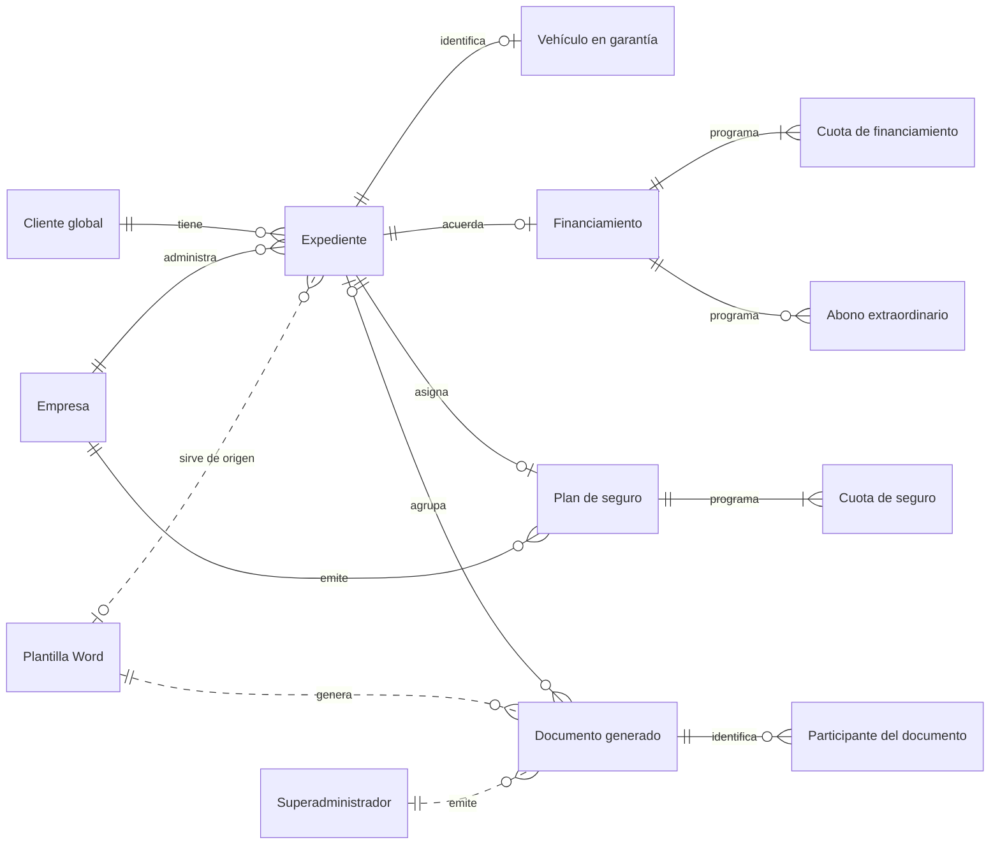

# Modelo de entidades para expedientes y contratos

Propuesta para revisión. La aplicación es de uso interno para las empresas participantes. Una sola cuenta, la de Randy, tiene el rol de **superadministrador** y acceso a todas las empresas y al **maestro global de clientes**. Cada **expediente** vincula un cliente de ese maestro con la empresa responsable y agrupa sus documentos. Puede incluir un vehículo y condiciones de financiamiento. La venta condicional y el pagaré auténtico se generan con el mismo plan de financiamiento. El acto y el pagaré de seguro se generan con el mismo plan de seguro.

## Diagrama entidad relación

El diagrama representa relaciones lógicas. Los bloques de vehículo, financiamiento y seguro pueden persistirse con la operación.

La plantilla de origen identifica el Word asociado al expediente. Cada documento registra la plantilla específica que lo produjo. Ambas referencias son históricas. Un documento generado fuera de un expediente puede carecer de operación. Las cardinalidades de cuotas y emisor aplican a planes completos.

## Entidades y datos

| Entidad | Datos que debe conservar |
| --- | --- |
| **Empresa** | Identificador, razón social, RNC y domicilio social. Perfil del socio gerente o representante con nombre legal, cédula y domicilio. Una empresa puede ser titular del expediente, emisora del seguro o cumplir ambos roles. |
| **Usuario** | Cuenta autenticada única de Randy con el rol de superadministrador. Tiene acceso a todas las empresas y figura como autor de las acciones que realiza. |
| **Cliente** | Identificador global, nombre legal, tipo y número de identificación, nacionalidad, estado civil, ocupación, domicilio, teléfono, correo y origen de fondos o ingresos declarado. El tratamiento y la frase de tránsito se pueden resolver para cada documento. |
| **Expediente** | Identificador, empresa titular y cliente. Puede incluir referencia, fecha del contrato, vehículo, plantilla de origen, financiamiento principal y plan de seguro. |
| **Vehículo en garantía** | Tipo, marca, modelo, año, color, matrícula o número de registro, placa, chasis y motor o número de serie. Se guarda como el vehículo registrado para esa operación. |
| **Financiamiento** | Fecha base del calendario, moneda, capital base pactado, penalidad de abono pactada para la operación, cuotas ordinarias y final, abonos extraordinarios. Se distingue el importe del capital del componente ordinario de la cuota final. |
| **Cuota de financiamiento** | Número de orden, vencimiento, tipo ordinaria o final y desglose de importe ordinario y capital. Importe total derivado de ambos componentes. |
| **Abono extraordinario** | Orden, vencimiento e importe editable. La tasa de penalidad se toma de las condiciones pactadas. El cargo por penalidad debe distinguirse del importe que se aplica al capital cuando se confirme su cálculo. |
| **Plan de seguro** | Operación, empresa emisora asignada, representante del emisor, moneda y calendario propio. La cantidad y el total se derivan de las cuotas. |
| **Cuota de seguro** | Número de orden, fecha de vencimiento e importe digitado por cuota. Cada fila pertenece al plan de seguro. |
| **Plantilla Word** | Identificador, tipo documental, empresas autorizadas, marcadores y referencia al archivo o revisión usada al generar. |
| **Documento generado** | Identificador, tipo documental, operación si aplica, referencia a la plantilla usada, fecha de firma consignada, fecha de generación, usuario generador y archivo resultante. Conserva los valores usados para emitirlo, incluidos los datos de los participantes y del plan cuando corresponda. |
| **Participante del documento** | Rol, orden cuando se repite un rol, referencia a la fuente si existe y datos que figuran en el documento. Los roles incluyen cliente, representante de empresa, representante del emisor, notario, testigos, otorgante y apoderado. El usuario generador figura como testigo cuando se le asigna ese rol. |

La cédula se guarda como texto para conservar sus ceros. La versión en letras y la versión numérica salen del mismo valor. Los importes se guardan en centavos y se presentan en números y letras a partir del mismo monto. Las cuotas y los abonos de este modelo representan vencimientos pactados. Los datos del notario salen de su configuración, incluyendo matrícula y domicilio profesional si el documento los pide. Los testigos usan su nombre legal, cédula y domicilio donde corresponda. La fecha del contrato, la fecha base del calendario y la fecha de firma de cada documento tienen usos propios, aunque puedan coincidir.

## Maestro global de clientes

Cada persona tiene una sola ficha en la aplicación y puede tener varios expedientes, incluso en la misma empresa. Cada expediente tiene una empresa responsable, su propio historial y los documentos que se generan desde él. Se puede abrir un expediente sin documentos y añadirlos después. El contrato base es opcional y se usa cuando un documento necesita una cláusula de origen.

El superadministrador puede consultar y editar cualquier ficha y ver sus expedientes en todas las empresas. Seleccionar una empresa sirve para filtrar expedientes o indicar cuál es la responsable de uno nuevo. El historial registra la cuenta que hizo cada cambio. Los documentos emitidos conservan los datos con los que se generaron. La API conserva las rutas de operaciones y los identificadores existentes para mantener sus vínculos con documentos e historial.

Cada Word se genera con una plantilla autorizada para la empresa de la operación. Cuando un rol aparece varias veces en un instrumento, el cuerpo, las firmas y la certificación toman los datos del mismo participante.

## Reglas de los calendarios

### Financiamiento principal

1. La fecha base propuesta es la firma de la venta. La primera cuota vence el mes siguiente y las siguientes vencen el mismo día de cada mes. El orden, la cantidad y las fechas que muestra cada Word salen de las mismas filas.
2. La última cuota contiene el componente ordinario de ese mes más el capital que corresponda. El total del calendario ordinario suma todas las filas, incluida la última, una sola vez. Los abonos extraordinarios se identifican aparte para poder aplicar la regla acordada sobre capital y total contractual.
3. El primer abono extraordinario vence cuatro meses después de la firma y los siguientes se programan cada cuatro meses hasta el último vencimiento. El importe de cada abono se edita en la operación. La penalidad se registra como condición de esa operación para conservar el porcentaje pactado con el cliente.
4. La venta y el pagaré toman el calendario y el compromiso de abonos de la misma revisión de datos. Si se cambia el plan después de generar uno de los documentos, la pareja debe emitirse con una revisión común. Los archivos ya generados conservan los datos con que se emitieron.

### Seguro

1. El plan guarda de **1 a 10 cuotas** cuando existe financiamiento de seguro. Se capturan fecha e importe por fila, con orden de vencimiento, y se calcula el total a partir de esas filas.
2. El acto y el pagaré usan la misma empresa emisora asignada, la misma revisión de cuotas y el mismo total. La empresa titular conserva el alcance del expediente. La asignación del emisor se valida contra los perfiles autorizados para ese uso.
3. Si el Word del pagaré de seguro expresa un importe mensual único, ese texto solo es válido para cuotas de igual importe. Con montos distintos, el Word debe mostrar el calendario o referenciarlo de forma explícita.

## Aplicación por documento

| Documento | Datos y observaciones |
| --- | --- |
| **Venta condicional y pagaré auténtico** | Consumen los mismos datos del comprador, empresa, vehículo, calendario y abonos. La venta del ejemplo tiene 23 cuotas ordinarias de RD$19,375 y una final de RD$794,375. Suman RD$1,240,000 y vencen el día 13. El pagaré dice 18 ordinarias más la final, que suman RD$1,143,125, y usa el día 7. Para ese ejemplo, la venta es la referencia propuesta porque su tabla cuadra y coincide con la nota del día de firma. |
| **Acto y pagaré de seguro** | Consumen el emisor y las cuotas de un solo plan. Los ejemplos muestran 10 cuotas de RD$9,198 frente a 4 de RD$10,272 y vencimientos distintos. Hay que confirmar si los dos Word describen la misma operación antes de reconciliar esos importes. |
| **Declaración jurada** | Toma datos del cliente, ocupación, origen de fondos, teléfono y correo. Usa la fecha del contrato donde el texto identifica el financiamiento y la fecha de firma en el acto. |
| **Entrega voluntaria** | Toma el vehículo, el cliente con cédula completa y domicilio, la empresa y su representante, el notario y los dos testigos. Para domicilios distintos entre muestras se usa el dato validado del expediente al generar. |
| **Levantamiento de oposición ante la DGII** | Registra por separado al otorgante y al apoderado con sus identidades y vincula el vehículo correcto. El mismo otorgante aparece en la comparecencia, firmas y certificación que correspondan. La muestra trae un otorgante distinto al nombre del archivo y deja el apoderado en blanco. |
| **Entrega de vehículo con fines de saldo** | El original está rotulado fuera de alcance. La nota de nombre de usuario queda registrada para esa plantilla. |

## Cómo encaja con lo que ya existe

- La migración usa `clients.id` como identificador global y conserva `client_operations.company_id` para identificar la empresa responsable. La API consulta el maestro global y el portal permite filtrar operaciones por empresa.
- El acceso a todas las empresas se deriva de la cuenta única de superadministrador, configurada en el servidor. La empresa de la operación determina qué plantillas y datos de empresa corresponden al documento.
- La migración agrupa fichas por identificación cuando coincide al ignorar espacios, guiones y mayúsculas. Conserva el ID más antiguo y el último valor disponible por campo. Los otros IDs siguen funcionando como alias y las fichas originales que se consolidaron quedan en un archivo interno para revisión. Las fichas sin identificación conservan sus registros y los expedientes mantienen sus operaciones, historial y archivos.
- Los perfiles de empresa y cliente se pueden ampliar con los datos documentales y resolver sus marcadores Word desde una fuente común. Algunas plantillas preparadas conservan fijos la empresa, el notario o un testigo.
- `client_operations` ya guarda `vehicle` y `financing`. El plan actual contiene cuotas de intereses, una última fila llamada `final_principal` y abonos cada cuatro meses desde el primer abono capturado. Queda por representar el desglose de la última cuota, guardar la penalidad y validar el anclaje a la firma y el límite del calendario.
- Hoy la operación puede guardar la cantidad de cuotas de seguro. El formulario del acto captura las filas para esa generación y la API valida que la cantidad sea positiva. El modelo objetivo persiste el emisor y las filas en el expediente y aplica el tope de 10.
- `generated_documents` ya permite vincular un archivo a la operación y guardar una copia del perfil de empresa. La propuesta amplía esa trazabilidad a la revisión de condiciones y a los datos de las partes que aparecieron en el archivo.
- En expedientes existentes, el importe guardado en `final_principal` se conserva como importe de la última cuota hasta confirmar su desglose. Una cantidad histórica de cuotas de seguro permite recuperar la cantidad, y las fechas y montos deben completarse con el calendario acordado.

Referencias del repositorio. [Modelo de clientes y operaciones](../services/api/src/modules/clients/dto.rs) · [Persistencia de expedientes](../supabase/migrations/20261111122547_company_clients_and_operations.sql) · [Perfiles de empresa](../supabase/migrations/20261110221252_company_profiles.sql) · [Membresías de empresa](../supabase/migrations/20261111000000_company_access.sql) · [Marcadores Word](../apps/portal/PLANTILLAS.md).

## Decisiones para cerrar en revisión

| Tema | Decisión pendiente |
| --- | --- |
| **Capital de la última cuota y total contractual** | Confirmar si la última cuota usa el capital original o el saldo después de abonos. Definir si el total declarado del contrato representa el calendario ordinario inicial o el total ajustado que incorpora los abonos. |
| **Abonos y penalidad** | Confirmar qué ocurre si el último abono coincide con la cuota final, si se retira la cláusula semestral de los Word y sobre qué base se cobra la penalidad. En los ejemplos aparecen referencias al monto abonado y al capital restante. |
| **Vencimientos de fin de mes** | Confirmar si, cuando el mes no tiene el día de firma, se usa su último día y se vuelve al día original en los meses siguientes. Aplicar la regla acordada a cuotas y abonos. |
| **Identidad del otorgante de DGII** | Confirmar en qué casos el cliente del expediente es el otorgante y quién registra los datos del apoderado. |
