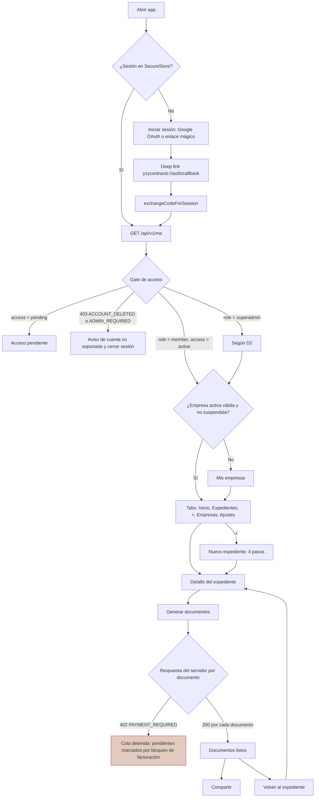
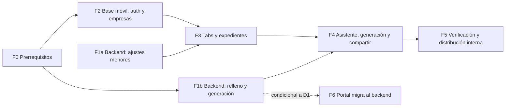

# Plan de implementación: YZY Contracts Mobile (Expo)

Revisado por Planner (Law) el 2026-11-16 · Estado: pendiente de decisiones D1–D4 · No listo para implementación

Plan de arquitectura y ejecución de la aplicación móvil de YZY Contracts (`apps/mobile`) para iOS y Android, conectada a Supabase Auth y a la API Rust (`services/api/`). La sección 18 resume qué cambió respecto a la versión anterior.

---

## 1. Decisiones de alcance confirmadas por Randy (no se reabren)

| # | Tema | Decisión | Se materializa en |
| :-- | :--- | :--- | :--- |
| 1 | Autenticación | Igual que el portal web (`apps/portal`): Google OAuth y enlace mágico por correo con Supabase Auth. Sin Sign in with Apple ni código de 6 dígitos en esta entrega. | Sección 6 · F2 |
| 2 | Relleno de documentos | En el backend (`services/api`): el servidor rellena las variables del `.docx`, convierte a PDF si corresponde y guarda el artefacto. | Secciones 5.1 y 5.2 · F1b |
| 3 | «Enviar por correo» en Documentos listos | Fuera de alcance. La pantalla ofrece Compartir (hoja nativa) y Volver al expediente. | Sección 8 · F4 |
| 4 | Usuarios soportados | Solo usuarios operadores. | Sección 6 (gate), D2 · F2 |
| 5 | Plataformas | iOS y Android. | Secciones 10 y 11 · F2, F5 |
| 6 | Servicios | Expo conectada a los mismos servicios: Supabase Auth y API Rust. | Secciones 4, 5, 6 y 9 |

El prototipo móvil muestra «Continuar con Apple», un código de 6 dígitos y «Enviar por correo». Las decisiones 1 y 3 prevalecen sobre el prototipo. La decisión 4 queda a la espera de D2 en lo que toca a la cuenta `superadmin` (sección 17).

---

## 2. Fuentes de diseño

- `docs/design/YZY CONTRACTS.html` no es el prototipo móvil. Es el prototipo web anterior: páginas Dashboard, Contratos, Nuevo contrato, Documentos generados, Configuración, Botones YZY LABS y Flujo de usuario; paleta `#0C0E12`, `#5B6270`, `#EEF0F4` y acento lima `#C8F031`; fuentes Geist e Inter. No debe usarse para la app.
- El prototipo móvil (11 marcos de 390×844) lo entregó Randy fuera del repositorio y no está versionado. Acción pendiente: versionarlo en `docs/design/` antes de la Fase 2.
- El prototipo móvil usa la paleta anterior a `458533c`. De él se toman composición y textos; colores y logo salen del portal (sección 7).
- Pantallas del prototipo móvil: Iniciar sesión, Acceso con correo, Código de verificación, Mis empresas, Inicio, Expedientes, Detalle del expediente, Nuevo expediente · Cliente, Nuevo expediente · Solicitud, Generar documentos, Documentos listos.
- Pantallas sin diseño: Revisa tu correo (enlace mágico), Acceso pendiente, aviso de cuenta no soportada, Plan de pagos (paso 3), Revisión (paso 4) y Ajustes. Siguen el sistema visual del prototipo (sección 7).

---

## 3. Flujo de la app



---

## 4. Arquitectura en el monorepo y reglas YZY

```text
yzy-contracts/
├── apps/
│   ├── portal/            # Portal web Next.js existente
│   └── mobile/            # Nueva app Expo (iOS + Android) con Expo Router
├── packages/
│   └── contracts-core/    # Funciones puras compartidas (decisión de Law)
├── services/
│   └── api/               # API Rust/Axum existente + módulo de relleno .docx
└── specs/
    └── openapi/
        └── portal-api.yaml   # Generado desde el código
```

- `pnpm-workspace.yaml` declara solo `apps/*`. Hay que agregar `packages/*` para `packages/contracts-core`.
- `apps/mobile` usa Expo Router. Las pantallas en `app/` son delgadas y delegan a `src/features/<feature>/` (ui, hooks, api, store y types colocados). Features: `auth`, `access`, `companies`, `dashboard`, `cases`, `case-intake`, `documents`, `settings`.
- `src/shared/` contiene solo primitivas transversales. `src/lib/` contiene adaptadores: cliente Supabase, cliente HTTP de la API y almacenamiento seguro.
- Las importaciones entre features pasan solo por `src/features/<feature>/index.ts`; no hay imports profundos. Sin lógica de negocio en pantallas. Sin `catch {}` vacíos.
- TypeScript `strict`. Sin `any` ni `// @ts-ignore` sin justificación. Sin archivos `.js` nuevos. Inglés en nombres de archivos, identificadores, ramas y commits.
- Decisión de Law: crear `packages/contracts-core` con las funciones puras que hoy viven en el portal y que móvil necesita para el asistente y la presentación:
  - `apps/portal/app/clientes/monthly-payment-plan.ts`: cálculo de cuotas que el cliente envía como filas en `Financing.interest_installments` (ver `services/api/src/modules/clients/dto.rs:633-651`).
  - `apps/portal/app/clientes/expediente-status.ts`: etiquetas de estado.
  - Máscaras de montos RD$ y etiquetas del catálogo documental.
  - El portal pasa a importarlas sin cambiar comportamiento. Alternativa descartada: copiar el código en móvil, porque dejaría dos implementaciones del calendario.

Árbol de rutas Expo Router:

```text
app/
├── (auth)/
│   ├── login.tsx              # Iniciar sesión (Google + correo)
│   ├── email.tsx              # Acceso con correo (enlace mágico)
│   └── email-sent.tsx         # Revisa tu correo (no hay pantalla de código OTP)
├── auth/
│   └── callback.tsx           # Deep link handler: yzycontracts://auth/callback
├── access-pending.tsx         # Acceso pendiente
├── unsupported-account.tsx    # Aviso de cuenta no soportada
├── companies.tsx              # Mis empresas (selector obligatorio / cambio de empresa)
├── (tabs)/
│   ├── _layout.tsx            # Tab bar inferior (Inicio, Expedientes, +, Empresas, Ajustes)
│   ├── index.tsx              # Inicio (KPIs, acciones rápidas, expedientes recientes)
│   ├── expedientes/
│   │   └── index.tsx          # Listado con búsqueda y chips de estado
│   ├── nuevo-placeholder.tsx  # Interceptado por el botón + → abre /nuevo-expediente
│   ├── empresas.tsx           # Cambio rápido de empresa activa
│   └── ajustes.tsx            # Cuenta, empresa activa, legales, cerrar sesión
├── expedientes/
│   └── [id]/
│       ├── index.tsx          # Detalle (Resumen | Documentos | Historial) + Generar documentos
│       ├── generar.tsx        # Selección múltiple + toggle PDF/Word + progreso
│       └── listos.tsx         # Documentos listos (Compartir + Volver al expediente)
└── nuevo-expediente/
    ├── index.tsx              # Paso 1 de 4: seleccionar cliente (+ Nuevo cliente)
    ├── solicitud.tsx          # Paso 2 de 4: préstamo, seguro y datos del vehículo
    ├── plan-pagos.tsx         # Paso 3 de 4: cuotas mensuales y abonos extraordinarios
    └── revision.tsx           # Paso 4 de 4: revisión y confirmación
```

---

## 5. Cambios en backend (`services/api`)

### 5.1 Relleno `.docx` en Rust

`native_word.rs` hoy solo lee y valida variables: `read_variables` (`services/api/src/modules/contracts/native_word.rs:23`), usado al registrar la plantilla (`services/api/src/modules/contracts/handlers.rs:159`). Usa `roxmltree` (`native_word.rs:6`), que es de solo lectura y no sirve para reescribir el XML. El plan anterior asumía que ya había escritura; no la hay.

El relleno necesita un escritor XML (por ejemplo, reescritura por eventos con `quick-xml` u otra librería que conserve el árbol). Implementer elige con estos criterios:

- Conserva atributos, namespaces y `xml:space`.
- Sin DTD ni entidades externas.
- Respeta los límites ya definidos en `native_word.rs:11-16`: 4096 entradas, 64 MiB expandidos, 8 MiB por parte XML, profundidad 128, 100 variables y 1000 ocurrencias.

Precedente en el repo: `services/api/src/modules/clients/loan_pdf.rs:213-256` ya rellena un `.docx` en Rust, pero con reemplazo de texto plano sobre una plantilla fija embebida (`loan_pdf.rs:20`). No es generalizable a plantillas subidas por usuarios, donde un marcador `{{clave}}` puede quedar partido entre varios `<w:t>`.

Superficie a portar desde el portal (el comportamiento debe quedar idéntico):

| Archivo (portal) | Líneas | Qué se porta |
| :--- | :--- | :--- |
| `apps/portal/app/contratos/native-document.ts` | 545 | Segmentación de párrafos y runs; contenedores protegidos y barreras (`:17-24`); dos modos de reemplazo, variables nativas `resolveNativeTargets` (`:202`) y vínculo por texto exacto `resolveTargets` (`:138`), elegidos en `:434-436`; saltos de línea a `<w:br/>` y `xml:space="preserve"` (`:236-255`); deduplicación de `RD$` (`:227`); expansión de filas del calendario en la venta condicional (`:438`) y ajuste de tabla (`:440-448`); extracción de la cláusula de compromiso para el pagaré (`:493-514`); plantillas de origen PDF se copian sin relleno (`:531-537`); límite de 20 MiB (`:8`). |
| `apps/portal/app/contratos/batch-document-generation.ts` | 407 | Orquestación por tipo, emisor de seguro, validaciones y mensajes. |
| `apps/portal/app/contratos/expediente-fields.ts` | 555 | Mapeo de campos, incluidas las claves `*_letras` (`:187-207`). |
| `apps/portal/app/contratos/contract-template-fields.ts` | 121 | Campos de plantilla de contrato. |
| `apps/portal/app/contratos/template-fields.ts` | 283 | Formatos `Intl.DateTimeFormat("es-DO")` (`:17-18`). |
| `apps/portal/app/contratos/native-field-kinds.ts` | 97 | Tipos de campo nativo. |
| `apps/portal/app/contratos/document-catalog.ts` | 131 | Catálogo documental. |
| `apps/portal/app/clientes/document-template-match.ts` | 22 | Compatibilidad plantilla–documento. |
| `apps/portal/app/clientes/operation-templates.ts` | 73 | Plantillas por operación. |
| `apps/portal/app/configuracion/empresas/company-fields.ts` | 377 | Campos de empresa. |

Total aproximado: 2.600 líneas de TypeScript.

Reglas de calendario: Law decide portar el comportamiento actual del portal sin cambios. Las decisiones pendientes de `docs/modelo-entidades-contratos.md:111-118` (capital de la última cuota, abonos y penalidad, vencimientos de fin de mes, otorgante DGII) se aplicarán después, a ambas implementaciones a la vez.

Resolución de plantilla en servidor: el portal recuerda la plantilla elegida en el `localStorage` del navegador (`apps/portal/app/clientes/operation-templates.ts:10`) y el backend no la ve. Por eso la petición acepta `contract_id` opcional. Si hay varias plantillas compatibles y no llega `contract_id`, el servidor responde con un código nuevo, `DOCUMENT_TEMPLATE_AMBIGUOUS` (422), y móvil pide elegir entre los candidatos.

### 5.2 Endpoints nuevos

Diseño decidido por Law; el contrato final lo genera utoipa.

`GET /api/v1/expedientes/{id}/available-documents?company_id=` Endpoint obligatorio (el plan anterior lo planteaba como opcional): sin él, móvil no puede saber qué plantillas son compatibles, porque la resolución se hace hoy en el navegador. `company_id` es obligatorio. Por cada `document_type` del catálogo devuelve:

- `status`: `ready | ambiguous | missing`.
- `candidates`: `[{ contract_id, name }]`.
- Último generado `{ id, created_at, format }` o `null`, para mostrar «Ya generado · se crea una versión nueva».

`PUT /api/v1/expedientes/{id}/documents/{document_id}`:

- `document_id` es un UUID generado por el cliente y la operación es idempotente, como el `PUT /api/v1/generated-documents/{id}` existente (`services/api/src/modules/generated_documents/mod.rs:69-94`): reintento idéntico → 200; reintento distinto → 409 `GENERATED_DOCUMENT_CONFLICT`.
- Body estricto: `{ company_id, document_type, format: "pdf" | "docx", contract_id? }`. Respuesta: `DocumentMetadata`.
- Un documento por petición. El renderizador PDF es síncrono y cada llamada debe caber en `REQUEST_TIMEOUT_SECS`. Móvil muestra el progreso documento a documento, como hace el portal hoy (`batch-document-generation.ts:219-397`).
- Alternativas descartadas: un lote síncrono (riesgo de timeout con varios PDF) y un job asíncrono con worker (más piezas; reconsiderar si los tiempos lo exigen).

Validaciones y facturación:

- `billing::require_generation_access` (`services/api/src/modules/billing/mod.rs:428-443`) valida solo alcance de empresa, operación y plantilla, y membresía. No valida facturación.
- Hoy la API nunca emite `PAYMENT_REQUIRED`: la variante existe (`services/api/src/error.rs:37`, código en `:123`, estado 402 en `:161`) pero nadie la construye. El portal bloquea empresas suspendidas solo en la interfaz (`apps/portal/app/empresas/company-picker.tsx:20-29`) y maneja el código por si llega (`batch-document-generation.ts:355-372`).
- El endpoint nuevo debe rechazar en servidor las empresas suspendidas (`billing_repo::suspended_company_ids`, usado en `services/api/src/modules/auth/mod.rs:121-132`) con `PAYMENT_REQUIRED` 402.
- Los endpoints existentes siguen sin esa validación. Queda fuera de alcance y se reporta como riesgo (sección 16).

Persistencia:

- `generated_documents` guarda el binario en la columna `artifact` de Postgres (`services/api/src/modules/generated_documents/repository.rs:24`, `:59`), no en R2. R2 guarda solo el original de la plantilla.
- `contract_id` es obligatorio en el registro (`generated_documents/dto.rs:86`). Se guarda `markdown` vacío, como hace el portal (`batch-document-generation.ts:345`), junto con el snapshot de empresa, `operation_id` y `document_type`.

PDF:

- Reutiliza `pdf_response` (`services/api/src/modules/contracts/render.rs:78-100`) y `DocumentRenderer::render_pdf` (`services/api/src/infrastructure/document_renderer.rs:67`), cliente HTTP a `POST /v1/render/pdf` con la cabecera `x-internal-api-key` (`document_renderer.rs:43-46`, `:76`).
- El servicio renderizador es `doc-extractor-api/renderer/server.py:173`, código de otro agente (Antigravity): se consume su contrato tal cual, sin cambios ahí.
- Límite: el menor entre 20 MiB y `UPLOAD_MAX_BYTES` (`services/api/README.md:71`).

Errores que móvil debe mapear (códigos en `services/api/src/error.rs:106-152`):

| HTTP | Código | Comportamiento en móvil |
| :--- | :--- | :--- |
| 401 | `UNAUTHENTICATED` | Cerrar sesión. |
| 402 | `PAYMENT_REQUIRED` | Detener la cola; marcar pendientes por bloqueo de facturación. |
| 404 | `COMPANY_NOT_FOUND`, `CLIENT_OPERATION_NOT_FOUND`, `CONTRACT_NOT_FOUND` | Mostrar error del documento. |
| 409 | `GENERATED_DOCUMENT_CONFLICT` | Mostrar conflicto de idempotencia. |
| 413 | `PAYLOAD_TOO_LARGE` | Mostrar error del documento. |
| 422 | `VALIDATION_ERROR`, `DOCUMENT_RENDER_FAILED`, `INVALID_DOCX_VARIABLES`, `INVALID_DOCX_TEMPLATE` | Mostrar error del documento. |
| 422 | `DOCUMENT_TEMPLATE_AMBIGUOUS` (nuevo) | Pedir elegir entre los `candidates`. |
| 503 | `DOCUMENT_RENDERER_UNAVAILABLE` | Permitir reintento. |
| 504 | `REQUEST_TIMEOUT` | Permitir reintento (mismo `document_id`). |

### 5.3 Ajustes a endpoints existentes

- `GET /api/v1/expedientes`: `company_id` es obligatorio (`services/api/src/modules/clients/dto.rs:30-32`) y el query usa `deny_unknown_fields` (`dto.rs:28`), así que hoy enviar `status` devuelve 422. Agregar `status: Option<OperationStatus>`. Valores reales: `solicitud | en_proceso | firma | desembolso | cerrado` (`dto.rs:81-88`).
- Conteo en Mis empresas: el prototipo muestra solo «N expedientes» o «Sin expedientes todavía». Los clientes son globales (`dto.rs:31`, comentario; `docs/modelo-entidades-contratos.md:66`) y `clients_total` del dashboard cuenta todos los clientes (`services/api/src/modules/clients/dashboard.rs:302`), por lo que se elimina `clients_count`. Decisión de Law: sin cambio de API en v1; el conteo sale de `GET /api/v1/expedientes?company_id=…&per_page=1` → `total`. Reversible: si hay muchas empresas, agregar el conteo a `GET /api/v1/companies`.
- Cambio de estado del expediente: la ruta real es `PATCH /api/v1/companies/{company_id}/clients/{client_id}/operations/{operation_id}` (`services/api/src/modules/clients/mod.rs:279`), no un `PATCH` sobre `/expedientes/{id}`.
- Spec OpenAPI: `specs/openapi/portal-api.yaml` se genera desde el código con `cargo run -- openapi > ../../specs/openapi/portal-api.yaml` (`services/api/README.md:133`) y una prueba detecta el desfase (`services/api/README.md:28`). No se edita a mano.

---

## 6. Autenticación en móvil («igual que el portal»)

Hechos del portal:

- Cliente con `flowType: "pkce"`, `persistSession`, `autoRefreshToken` y `detectSessionInUrl` (`apps/portal/lib/supabase.ts:10-17`).
- Google con `signInWithOAuth` y `redirectTo` a `${origin}/auth/callback` (`apps/portal/components/arc/blocks/sign-in/sign-in.tsx:106-108`).
- Enlace mágico con `signInWithOtp`, `shouldCreateUser: false` y `emailRedirectTo` (`sign-in.tsx:135-140`); 429 → mensaje de espera (`:143`); `otp_disabled` y `user_not_found` se tratan como éxito para no revelar correos registrados (`:147-149`).

Implicaciones en móvil:

- Cuentas nuevas por Google. `shouldCreateUser: false` aplica solo al enlace mágico. Google OAuth sí crea la cuenta si no existe, y esa cuenta queda `pending` hasta que el superadministrador la habilite. Una cuenta pendiente solo puede llamar `GET /api/v1/me` (`services/api/src/modules/auth/middleware.rs:56-57`).
- Redirect. Se usa `yzycontracts://auth/callback` con Development Build (Expo Go no sirve). Hay que agregarlo al allow-list de redirects del Auth compartido `yzylabs-supabase-auth` en H01.
  - Riesgo operativo crítico: ese Auth lo comparten varios productos. Su configuración en ejecución divergió del disco y recrearlo con compose borró antes Google, Apple, SMTP y redirects. Hubo una reconciliación posterior, pero su vigencia debe verificarse en vivo antes de cualquier cambio.
  - El cambio lo ejecuta DevOps con aprobación de Randy: comparar primero la configuración en ejecución (`docker inspect`) con el `.env` del host, respaldar, cambiar solo el allow-list y no recrear otros servicios. Si la configuración en ejecución y el disco no coinciden, se detiene y se escala.
  - Este plan no contiene valores ni rutas de secretos.
- Enlace mágico. Con PKCE el `code_verifier` queda en el dispositivo que pidió el enlace, así que el correo debe abrirse en ese mismo teléfono. Probar Gmail, Apple Mail y Outlook, cuyos navegadores internos pueden no abrir el esquema propio. La plantilla de correo del Auth es compartida y no se modifica.
- Cloudflare. `ops/deployment/README.md:18` documenta que el desafío de bots de Cloudflare en `https://supabase.yzylabs.com` devuelve 403 a las llamadas de la API, que no son de navegador. Las llamadas nativas de `supabase-js` desde la app (token y refresh) podrían recibir el mismo 403. Prueba técnica obligatoria al inicio de la Fase 2; si falla, se escala a Randy (este plan no prevé solución alternativa).
- Sesión. Decisión de Law: adaptador de almacenamiento de `supabase-js` sobre `expo-secure-store` que divide la sesión en fragmentos. Motivo: la documentación de Expo indica que algunas versiones de iOS rechazaron valores mayores a unos 2048 bytes y que Expo no impone un límite propio (hay que manejar el error nativo); la sesión de Supabase con identidad de Google puede superarlo. Descartados: SecureStore en un solo valor (riesgo de rechazo) y el patrón `LargeSecureStore` (blob cifrado en `AsyncStorage`), contrario a la regla YZY de no guardar nada sensible en `AsyncStorage`. La empresa activa no es sensible: se guarda en `AsyncStorage` con la clave `yzy-contracts:active-company:{accountId}`, igual que el portal (`apps/portal/lib/portal-access.tsx:55`).
- Gate con `GET /api/v1/me` (`services/api/src/modules/auth/mod.rs:36-57`):
  - `role` es `superadmin | member` (`:59-64`); `access` es `active | pending` (`:66-71`). No existe un rol «operador»: todo usuario no superadministrador es `member`.
  - `companies` devuelve todas las empresas activas para cualquier usuario habilitado (`auth/mod.rs:93-101`); `has_company_membership` (`supabase/migrations/20261113050000_enabled_user_access.sql:28-36`) ya no consulta membresías.
  - `overdue_company_ids` marca empresas suspendidas: móvil las muestra bloqueadas en Mis empresas, como el portal.
  - El tratamiento de `superadmin` depende de D2.
- Cerrar sesión: `supabase.auth.signOut({ scope: "local" })`, borrar los fragmentos de SecureStore y los archivos en caché.
- App Store, guideline 4.8. Una app que usa Google Sign-In para la cuenta principal debe ofrecer también un servicio de inicio de sesión equivalente (en la práctica, Sign in with Apple), salvo excepciones. La aplicable sería «app empresarial o de negocio que exige iniciar sesión con una cuenta empresarial existente». Es discutible: aquí cualquier cuenta de Google puede iniciar sesión y queda pendiente. Riesgo alto de rechazo; ver D4. Android y Google Play no tienen esta exigencia.

---

## 7. Diseño visual (marca vigente del portal)

La marca cambió el 2026-11-17 (`458533c`, «Cambiar el branding del portal al verde y azul de Inversiones Indriago Martínez»): el burdeos pasa a verde `#00803e`, la tinta a azul `#1b1f57` y el azul del logo `#2a3084` entra como color de información y de la placa del logo. El prototipo móvil sigue con la paleta anterior (`#14213D` y burdeos `#7A1F2B`).

Regla: del prototipo se toman composición, jerarquía, textos y radios; los colores y el logo salen del portal. La fuente de verdad es `apps/portal/app/globals.css:1-61` (tema claro) y `apps/portal/components/brand/brand-mark.tsx:9-12` (logo).

| Uso en móvil | Antes (prototipo) | Token del portal | Valor para React Native |
| :--- | :--- | :--- | :--- |
| Fondo | `#E7E3DC` | `--brand-stone` / `--background` | `#eceef4` (gris frío, `422b351`) |
| Superficie / tarjetas | `#F8F7F4` | `--surface` | `#f8f9fc`; elevada `--surface-raised` `#ffffff` |
| Borde de tarjeta | `#D6D0C6` | `--border` (ink 12 % sobre stone) | `#cfd3e1`; sutil `#d9dce7`; fuerte `#aab0c7` |
| Texto principal y barra de pestañas | `#14213D` | `--brand-ink` / `--foreground` | `#1b1f57` |
| Texto secundario | `#4B5468` | `--text-secondary` (ink 68 %) | `#545d89`; atenuado `--text-muted` `#757ea2` |
| Texto sobre barra oscura | `#C9CDD6` | `--sidebar-text` (stone 82 % con blanco) | `#eff1f6`; activo `#ffffff` |
| Acento (botón +, pestaña activa, CTA, estado) | `#7A1F2B` | `--accent` = `--brand-green` | `#00803e`; presionado `--accent-hover` `#006a33`; fuerte `#00592b`; texto encima `#ffffff` |
| Chip / avatar suave | `#E3C6C4` | `--avatar-surface` (green 16 % sobre stone) | `#ccdcd6` |
| Información, chip Word | — | `--brand-navy` / `--format-word-*` | `#2a3084` sobre `#d2d6e7` |
| Chip PDF | — | `--format-pdf-*` | `#00803e` sobre `#d0dfd9` |
| Error y bloqueo (402, validaciones) | burdeos / `#B00020` | `--danger` | `#b3261e` |
| Advertencia | — | `--warning` | `#9a5b00` |
| Tipografía | Inter | `--font-inter` (cuerpo) y `--font-display` = Geist (marca y títulos), `apps/portal/components/arc/foundation.css:77` | Inter para cuerpo y Geist para marca y títulos, cargadas con `expo-font` |

- `color-mix()` no existe en React Native: los valores derivados de la tabla están precalculados en OKLab, igual que los mezcla el navegador. Si cambia un color base, se recalculan.
- El error deja de ser burdeos: en la marca nueva va en rojo para no confundirse con el acento verde (mensaje de `458533c`).
- Logo: el `BrandMark` del portal con sus dos variantes. `ink`: placa `#2a3084`, eslabones `#eceef4` y `#2fb36a`. `stone`: placa `#f7f8fb`, eslabones `#2a3084` y `#00803e`. En móvil se porta como componente con `react-native-svg`. El ícono de la app y el splash parten de `apps/portal/app/icon.svg`, que usa la placa `#2a3084`. Se mantiene el pie «YZY Contracts powered by YZY LABS SRL» del prototipo.
- Modo oscuro: el portal lo define en `apps/portal/app/globals.css:63-97` (acento `#2fb36a`, tinta `#0d1033`). Si móvil lo soporta, toma esos valores; esta entrega no lo exige.
- Tokens en móvil: `src/shared/theme/tokens.ts` con los valores de la tabla. Una prueba unitaria lee `globals.css` y falla si los colores base (`--brand-stone`, `--brand-ink`, `--brand-navy`, `--brand-green`, `--surface`, `--danger`, `--warning`) difieren de los de móvil, para que un cambio de marca futuro en el portal no deje la app desfasada.
- Radios del prototipo, sin cambio: tarjetas 16, botones y campos 14, controles pequeños 8 y 6, chips 999.
- La paleta de `docs/design/YZY CONTRACTS.html` (prototipo web anterior, sección 2) tampoco se usa.

---

## 8. Detalle por pantalla y servicios

La autenticación y el gate están en la sección 6.

1. Mis empresas
   - Muestra las empresas activas de `GET /api/v1/me` con «N expedientes» o «Sin expedientes todavía» (conteo según 5.3). Las empresas suspendidas se muestran bloqueadas.
   - Al elegir empresa se persiste por `accountId` en `AsyncStorage` (sección 6) y se navega a `/(tabs)`.

2. Inicio (`GET /api/v1/dashboard?company_id=`, obligatorio; `services/api/src/modules/clients/dashboard.rs:21-23`)
   - Campos confirmados: `time_saved_minutes`, `documents_total`, `unsigned_cases`, `pending_disbursement_cases`, `disbursed_cases`, `disbursed_this_month`, `recent_cases`, `status_counts` (`dashboard.rs:27-45`).
   - Encabezado con empresa activa y avatar de iniciales.
   - Tarjeta destacada: Tiempo ahorrado y documentos.
   - Métricas: Sin firmar, Sin desembolsar, Desembolsados (incluye `disbursed_this_month`).
   - Acciones rápidas: Nuevo expediente (`/nuevo-expediente`) y Generar documento (selector de expediente o navegación a Expedientes).
   - Expedientes recientes (`recent_cases`) con navegación al detalle.

3. Expedientes (`GET /api/v1/expedientes`)
   - Parámetros: `company_id` (obligatorio), `q` (cliente, cédula o referencia), `page`, `per_page` (máx. 100) y `status` tras 5.3.
   - Paginación infinita y chips de estado.

4. Detalle del expediente
   - `GET /api/v1/expedientes/{id}` devuelve `Operation`; el cliente se obtiene con `GET /api/v1/clients/{client_id}`.
   - Cabecera: referencia (por ejemplo, `IAC-0003`), badge de estado, cliente, cédula, teléfono, monto solicitado, fecha de firma, vehículo y cuota del seguro. El estado se actualiza con la ruta `PATCH` de 5.3.
   - Pestañas internas:
     - Resumen: datos de préstamo, vehículo y plan de pagos.
     - Documentos: `GET /api/v1/generated-documents?operation_id=` (`generated_documents/dto.rs:192`); descarga con `GET /api/v1/generated-documents/{id}/artifact` con Bearer.
     - Historial: `GET /api/v1/clients/{client_id}/timeline?operation_id=`.
   - Botón primario fijo: Generar documentos.

5. Nuevo expediente (asistente de 4 pasos)
   - Paso 1, Cliente: `GET /api/v1/clients` con búsqueda y creación rápida con `POST /api/v1/clients`, manejando `CLIENT_IDENTITY_CONFLICT` (409, `services/api/src/error.rs:114`).
   - Paso 2, Solicitud: fecha de solicitud, fecha de firma, monto solicitado, cuota de seguro, tipo, marca, modelo, año, color, matrícula, placa, chasis y motor.
   - Paso 3, Plan de pagos: usa `packages/contracts-core`; monto de cuota y cantidad de cuotas; envía montos en centavos (`*_minor`). Los abonos extraordinarios los programa el servidor cada cuatro meses desde la firma (`dto.rs`, `Financing::schedule_extraordinary`). Equivalente a `intake-payment-plan-step.tsx` del portal.
   - Paso 4, Revisión: resumen de cliente, vehículo, préstamo y plan; crea con `POST /api/v1/clients/{client_id}/operations` (`OperationWrite`: `company_id` obligatorio, referencia automática si se omite) y redirige al detalle del expediente.

6. Generar documentos y Documentos listos
   - Generar documentos: checklist según `available-documents` (5.2), con la marca «Ya generado · se crea una versión nueva». Toggle PDF | Word y botón «Generar N documentos». Genera un documento por petición `PUT` con progreso por documento; ante `DOCUMENT_TEMPLATE_AMBIGUOUS` pide elegir plantilla; ante 402 detiene la cola.
   - Documentos listos: lista de archivos generados. Compartir descarga al caché con `expo-file-system` (con Bearer) y abre la hoja nativa con `expo-sharing`; el archivo se borra al terminar. Volver al expediente. Sin «Enviar por correo» (decisión 3).

7. Ajustes: correo de la cuenta, empresa activa (con acceso directo a cambiarla), enlaces a Términos y Política de privacidad (las URL las define Randy; no se inventan aquí) y Cerrar sesión (sección 6).

---

## 9. Contrato OpenAPI en móvil

Hoy el portal escribe sus tipos a mano (`apps/portal/app/clientes/clients-api.ts:55-56`) y no usa zod ni generador (`apps/portal/package.json`).

Decisión de Law para móvil:

- Generar tipos TS desde `specs/openapi/portal-api.yaml` (por ejemplo, con `openapi-typescript`) en `apps/mobile/src/lib/api/`, con una verificación en CI de que están al día.
- Validar con zod cada respuesta consumida, en la frontera (`src/features/*/api`), tipado contra los tipos generados.
- Validar con zod `.strict()` las entradas del usuario y los parámetros de deep link, fallando cerrado.
- El modo de validación de las respuestas de la API depende de D3.

---

## 10. Configuración por entorno

Solo existen el entorno local (`docker-compose.yml`) y producción (`ops/deployment/README.md`). No hay staging; el plan anterior lo mencionaba.

- Variables públicas: `EXPO_PUBLIC_SUPABASE_URL`, `EXPO_PUBLIC_SUPABASE_ANON_KEY`, `EXPO_PUBLIC_API_BASE_URL`.
- Se definen por perfil EAS (`development`, `preview`, `production`) en las variables de entorno de EAS y se leen desde `app.config.ts`. Nada en un `app.json` versionado.
- Todo `EXPO_PUBLIC_*` queda en el bundle: solo valores públicos; nunca service role ni claves internas.
- Contra qué entorno apuntan las builds de prueba: D4.

---

## 11. Distribución

EAS Build y EAS Submit.

- Android: Google Play, pista de pruebas internas.
- iOS: TestFlight; el canal de publicación depende de D4.
- Prerrequisitos de Randy: cuenta Apple Developer, cuenta Google Play Console, bundle ID y package name (no se inventan aquí).
- Despliegue al terminar (mandato de `AGENTS.md`): la API se despliega según `ops/deployment`; la app se entrega en pistas internas; la publicación pública requiere aprobación de Randy.

---

## 12. Seguridad

- PKCE.
- Tokens solo en SecureStore fragmentado; nada sensible en `AsyncStorage`.
- Sin `Authorization` en logs ni en herramientas de errores.
- Solo HTTPS.
- Deep links con allow-list: solo `auth/callback`; el resto se ignora.
- No renderizar HTML no confiable.
- Archivos descargados en caché y borrados tras compartir.
- Validación en servidor de la suspensión por facturación (5.2).
- Observación fuera de alcance, para Verifier: `GET /api/v1/expedientes/{id}` no recibe el usuario ni valida empresa (`services/api/src/modules/clients/mod.rs:73-81`). Hoy todo usuario habilitado ve todas las empresas, así que no amplía el acceso, pero queda sin defensa si cambia el modelo de acceso.

---

## 13. Estrategia de pruebas

- Rust: pruebas unitarias del relleno (marcadores partidos entre runs, contenedores protegidos, saltos de línea, `RD$`, montos y fechas en letras es-DO, filas del calendario, cláusula del pagaré, plantilla PDF de origen) y de integración con el patrón existente de `services/api/tests/` (`cargo test`).
- Paridad portal ↔ backend: fixtures Word sintéticos en `fixtures/` con valores esperados. El XML de `word/*.xml` generado por Rust debe coincidir, tras normalizar, con el de `fillOriginalWord` (`native-document.ts:416-461`). Es obligatoria mientras existan dos implementaciones (D1).
- Móvil:
  - Unitarias (`jest-expo`) de esquemas zod, gate de acceso y adaptador de SecureStore.
  - E2E en simulador iOS y emulador Android contra el stack local.
  - Matriz manual de autenticación: Google; enlace mágico desde Gmail, Apple Mail y Outlook en el mismo dispositivo; cuenta pendiente; empresa suspendida.
- Marca: prueba de paridad de tokens entre `apps/portal/app/globals.css` y `src/shared/theme/tokens.ts` (sección 7).
- Solo datos sintéticos en fixtures, pruebas y ejemplos (exigido por `CLAUDE.md` y `AGENTS.md` del repo).

---

### Compatibilidad con el portal por fase

- F0. Registrar un acceso web correcto con Google y otro por correo antes de ampliar los redirects. Conservar los callbacks actuales y comprobar ambos accesos y la renovación de una sesión web existente después del cambio. Si falla alguno, restaurar la configuración previa por el procedimiento autorizado.
- F1a. Con expedientes sintéticos de dos empresas, comparar el listado antes y después sin enviar `status`: mismos elementos, orden, total, búsqueda y paginación para la empresa activa. Repetir con filtro y comprobar el total filtrado.
- F1b. Aplicar el nuevo bloqueo de facturación en la ruta nueva. `require_generation_access` también se usa en renderizado, facturación y persistencia del portal. Probar el cliente web actual contra la API candidata, incluida la generación individual y por lote, la descarga del histórico y la consulta desde el portal de un documento creado por móvil.
- F2. Al extraer `contracts-core`, incluir su manifiesto antes de la instalación congelada y sus fuentes antes del build en `apps/portal/Dockerfile`. Permitir esos archivos en `Dockerfile.dockerignore` y cubrir cambios del paquete y del workspace en los filtros de `.github/workflows/deploy.yml`. Construir y arrancar la imagen standalone con el mismo contexto que producción. Comparar cuotas, fechas, redondeos y etiquetas antes y después con los mismos datos sintéticos.
- F6. Activar el generador de servidor mediante una opción reversible. Probar la plantilla oficial, la elección guardada por cuenta y empresa y la selección ambigua, en Word y PDF. Comparar contenido, paginación y registros del histórico. Ensayar el regreso al generador web sin perder documentos ni duplicar registros. Retirar el camino anterior en un cambio posterior y conservar los resultados esperados como pruebas de regresión.

## 14. Fases, dependencias y criterios de aceptación



| Fase | Entregables | Depende de | Criterio de aceptación verificable |
| :--- | :--- | :--- | :--- |
| F0 Prerrequisitos | Decisiones D1–D4; prototipo móvil versionado en `docs/design/`; cuentas de tiendas y bundle IDs; procedimiento del allow-list aprobado; prueba de Cloudflare. | Randy | D1–D4 registradas; prototipo en el repo; allow-list aplicado según el procedimiento de la sección 6; llamadas nativas de `supabase-js` sin 403 de Cloudflare. |
| F1a Backend, ajustes menores | Filtro `status`; spec regenerado; pruebas. | Nada (puede empezar ya) | `GET /expedientes?status=firma` filtra; la prueba de desfase del spec está en verde. |
| F1b Backend, relleno y generación | Módulo de relleno, `available-documents`, `PUT …/documents/{document_id}`, validación de suspensión, suite de paridad. | F0 (D1) | Paridad en verde para todos los tipos del catálogo; reintento idempotente; 402 en empresa suspendida; PDF vía el renderizador existente. |
| F2 Base móvil, auth y empresas | Proyecto Expo, `contracts-core`, cliente Supabase, gate, Mis empresas. | F0 (allow-list aplicado, Cloudflare verificado, prototipo). Paralela a F1. | Login con Google y enlace mágico en iOS y Android; cuenta pendiente y empresa suspendida bloqueadas; la sesión sobrevive a un reinicio. |
| F3 Tabs y expedientes | Inicio, Expedientes, Detalle, Ajustes. | F2 y F1a | Las pantallas consumen los endpoints de la sección 8 con tipos generados y respuestas validadas. |
| F4 Asistente, generación y compartir | Asistente de 4 pasos, Generar documentos, Documentos listos. | F1b y F3 | Un expediente creado desde móvil genera PDF y Word idénticos a los del portal para los mismos datos; 402 detiene la cola. |
| F5 Verificación y distribución interna | Verificación independiente (Verifier); builds en pistas internas. | F4 | Aprobación de Verifier; builds disponibles en TestFlight y en pruebas internas de Google Play. |
| F6 (condicional a D1) | Migración reversible del generador web según §13. | F1b y D1 = (a) | Portal genera los mismos documentos usando el backend; reversión ensayada y fixtures conservados. |

---

## 15. Propuesta de módulos nuevos (regla YZY)

Aplica a `apps/mobile`, al módulo de relleno en `services/api` y a `packages/contracts-core`.

| Módulo | Tradeoffs | Alternativas consideradas | Riesgos de seguridad | Reversibilidad |
| :--- | :--- | :--- | :--- | :--- |
| `apps/mobile` | Segunda superficie de presentación a mantener, a cambio de reutilizar Auth y API sin duplicar servicios. | Las decisiones 5 y 6 de Randy fijan Expo sobre los mismos servicios; esta revisión no evaluó otras plataformas. | Sesión, deep links y archivos en caché (sección 12); allow-list del Auth compartido (RISK-01). | Aislada en `apps/mobile`; la API y el portal no dependen de ella. |
| Módulo de relleno `.docx` en `services/api` | Una sola implementación de servidor y documentos idénticos entre canales, a cambio de portar unas 2.600 líneas TS y mantener una suite de paridad hasta D1/F6. | Reusar el relleno TS en móvil (descartada por la decisión 2 de Randy); lote síncrono y job asíncrono con worker (descartados en 5.2). | Procesa plantillas subidas por usuarios: sin DTD ni entidades externas, con los límites de `native_word.rs:11-16`; validación de suspensión por facturación en servidor. | Los endpoints nuevos son aditivos; el portal conserva su generador hasta F6; F2 sí cambia su empaquetado. |
| `packages/contracts-core` | Un solo calendario de cuotas y etiquetas, a cambio de tocar el portal para importarlo (sin cambio de comportamiento). | Copiar el código en móvil (descartada: dos implementaciones del calendario). | Funciones puras sin E/S ni credenciales; riesgo bajo. | El portal puede volver a sus archivos locales; no hay migración de datos. |

---

## 16. Riesgos

| ID | Severidad | Riesgo | Mitigación según este plan |
| :--- | :--- | :--- | :--- |
| RISK-01 | CRÍTICO | Allow-list del Auth compartido en H01: la configuración en ejecución divergió del disco (reconciliación posterior sin verificar en vivo) y recrear el servicio borró antes Google, Apple, SMTP y redirects. | Procedimiento de DevOps con aprobación de Randy (sección 6); parte de F0. |
| RISK-02 | ALTO | Divergencia de dos rellenadores (portal y backend) hasta D1/F6. | Suite de paridad obligatoria (sección 13); D1. |
| RISK-03 | ALTO | Rechazo de App Store por la guideline 4.8. | D4; canal y nota de revisión. |
| RISK-04 | ALTO | El desafío de Cloudflare devuelve 403 a clientes nativos. | Prueba obligatoria al inicio de F2; si falla, escalar a Randy. |
| RISK-05 | ALTO | Tamaño del port (unas 2.600 líneas TS). | Alcance acotado a comportamiento actual; paridad por fixtures; F1b separada de F1a. |
| RISK-06 | MEDIO | Enlace mágico abierto en otro dispositivo o en un navegador interno. | Prueba manual con Gmail, Apple Mail y Outlook; mensaje en `email-sent.tsx`. |
| RISK-07 | MEDIO | Plantillas ambiguas sin la preferencia guardada en el navegador. | `contract_id` opcional y `DOCUMENT_TEMPLATE_AMBIGUOUS` (5.1). |
| RISK-08 | MEDIO | Reglas de calendario pendientes en `docs/modelo-entidades-contratos.md:111-118`. | Portar el comportamiento actual; aplicar los cambios después a ambas implementaciones. |
| RISK-09 | MEDIO | Los endpoints existentes no validan suspensión por facturación. | Fuera de alcance; solo el endpoint nuevo valida (5.2). |
| RISK-10 | BAJO | N llamadas para los conteos de Mis empresas. | Reversible: mover el conteo a `GET /api/v1/companies` (5.3). |

---

## 17. Decisiones abiertas (para Randy)

D1. ¿El portal migra al relleno en backend?
- Importa porque cambia la arquitectura: define si habrá una o dos implementaciones del relleno.
- (a) Sí, en F6 tras la paridad. Recomendada: una sola implementación y documentos idénticos entre canales.
- (b) No: conviven dos implementaciones con la suite de paridad permanente.
- (c) Migrar el portal antes de construir móvil.

D2. ¿Qué hace móvil con la cuenta `superadmin`?
- Contexto: `docs/modelo-entidades-contratos.md:49` dice que la única cuenta de superadministrador es la de Randy; el plan anterior la bloqueaba. La decisión 4 («solo operadores») no resuelve este caso por sí sola.
- (a) Permitirla como operador, sin funciones de administración ni facturación. Recomendada.
- (b) Bloquearla con un aviso de usar el portal.

D3. Validación de respuestas de la API en móvil frente a la regla zod `.strict()`.
- Contexto: las versiones instaladas de una app conviven meses con una API que agrega campos; `.strict()` en respuestas haría fallar apps ya publicadas ante cualquier campo nuevo.
- (a) `.strict()` en entradas del usuario y deep links; en respuestas de la API, esquemas que ignoran campos desconocidos y fallan cerrado ante campos faltantes o de tipo incorrecto. Recomendada.
- (b) `.strict()` también en respuestas, con la política de que todo campo nuevo exige publicar la app antes.

D4. Canal iOS y entorno de pruebas.
- (a) App no listada o Custom App (Apple Business Manager) con una nota de revisión que invoque la excepción de app empresarial. Recomendada.
- (b) App Store pública.
- (c) Solo TestFlight.
- Si Apple rechaza por 4.8, Randy decide entonces si agrega Sign in with Apple; el plan no lo construye de antemano.
- Entorno: no hay staging. Se recomienda builds `preview` contra el stack local con datos sintéticos y builds `production` contra producción.

---

## 18. Revisión de Planner

Cambios respecto a la versión anterior:

- Prototipo mal referenciado y paleta incompleta (faltaba `#4B5468`).
- `native_word.rs` solo lee; el relleno requiere un escritor XML.
- Los artefactos viven en Postgres, no en R2.
- `require_generation_access` no valida facturación y `PAYMENT_REQUIRED` no se emite.
- `available-documents` deja de ser opcional y la generación es por documento e idempotente.
- La plantilla elegida se recuerda en el `localStorage` del navegador.
- `ListCases` exige `company_id` y rechaza campos desconocidos.
- Ruta real del `PATCH` de estado.
- `clients_count` eliminado.
- Spec OpenAPI generado desde el código.
- Sin staging.
- Autenticación: Google crea cuentas pendientes; allow-list del Auth compartido; Cloudflare; mismo dispositivo para el enlace; SecureStore fragmentado; guideline 4.8.
- Se agregan: reglas YZY, OpenAPI en móvil, entornos, distribución, pruebas, fases con dependencias y criterios, diagramas y decisiones abiertas.
- Marca actualizada al verde y azul de `458533c` (2026-11-17): tokens del portal con valores precalculados para React Native, error en rojo, Geist para marca y títulos, logo `BrandMark` y prueba de paridad de tokens.
