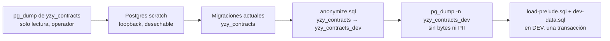

# Instancia DEV aislada de la API

Esta carpeta permite levantar la API contra una instancia Supabase/Auth **DEV** en otro host, con su propio esquema y su propio rol, sin tocar el código de producción.

## Garantías

- **PROD no cambia.** `CONTRACTS_BUILD_ENV` vale `production` por defecto. En ese caso el Dockerfile compila el código tal cual está en el repositorio y no ejecuta ninguna transformación. El checkout nunca se modifica: la renombración solo corre sobre una copia dentro del builder de Docker.
- **DEV no puede nombrar objetos de PROD.** La renombración cambia, por palabra completa, `yzy_contracts` por `yzy_contracts_dev` (esquema, ledger `_sqlx_migrations` y el ajuste `yzy_contracts_dev.superadmin_id`) y `yzy_contracts_app` por `yzy_contracts_dev_app` (rol). Después de renombrar, el build falla si queda cualquier nombre de PROD (`transform-dev-schema.sh` comprueba `\byzy_contracts(_app)?\b`).
- **La copia de datos se anonimiza antes de salir del servidor scratch.** Nunca se ejecuta en DEV ni en PROD.

## Build

```bash
# Desde la raíz del repositorio (el contexto debe ser la raíz).
docker build -f services/api/Dockerfile \
  --build-arg CONTRACTS_BUILD_ENV=development \
  -t yzy-contracts-api:dev-<commit> .
```

| Build arg | Valores | Default | Efecto |
|---|---|---|---|
| `CONTRACTS_BUILD_ENV` | `production`, `development` | `production` | `development` renombra esquema y rol en la copia del builder. Cualquier otro valor falla el build. |

No hay ninguna otra variable de build. Las de runtime se listan abajo.

## Transformación (`transform-dev-schema.sh`)

| Comando | Qué hace |
|---|---|
| `apply <raíz>` | Reescribe `services/api/src/**/*.rs` y `supabase/migrations/*.sql` bajo `<raíz>`. Lo usa el Dockerfile sobre `/src`. |
| `bootstrap <archivo>` | Imprime `supabase/local/bootstrap.sql` con la misma renombración, para el host DEV. |

Pruebas: `sh services/api/dev-build/test-transform.sh` (trabaja sobre una copia temporal y comprueba que los conteos de esquema y rol se conservan, que no queda ningún nombre de PROD y que el checkout no cambia).

## Rol, esquema y bootstrap en DEV

| Objeto | Nombre en DEV | Notas |
|---|---|---|
| Esquema | `yzy_contracts_dev` | Creado por el bootstrap y por la migración inicial. |
| Ledger | `yzy_contracts_dev._sqlx_migrations` | Lo crea `migrate`. |
| Rol runtime | `yzy_contracts_dev_app` | `NOLOGIN NOINHERIT` al migrar. El login y la contraseña se fijan fuera de banda. |
| Usuario DEV (propietario) | UUID de tu elección en Auth DEV | Es `CONTRACTS_SUPERADMIN_ID`. Debe existir en `auth.users` antes de cargar la copia, y tener fila en `profiles`. |

Pasos, en orden (el host DEV tiene su propio Supabase; no uses el bootstrap sobre un Supabase compartido sin revisarlo):

1. Crea en Auth DEV el usuario propietario y anota su UUID.
2. Bootstrap, con un rol de propietario de la base DEV:
   ```bash
   sh services/api/dev-build/transform-dev-schema.sh bootstrap supabase/local/bootstrap.sql > /secure/dev-bootstrap.sql
   psql "$DEV_OWNER_URL" -v ON_ERROR_STOP=1 -f /secure/dev-bootstrap.sql
   ```
3. Migraciones, con la imagen DEV:
   ```bash
   docker run --rm --env-file /secure/dev-migrate.env yzy-contracts-api:dev-<commit> migrate
   # dev-migrate.env: MIGRATION_DATABASE_URL=<URL del propietario DEV>
   #                  CONTRACTS_SUPERADMIN_ID=<UUID del propietario DEV>
   ```
4. Rol runtime, fuera de banda. La contraseña viene de tu gestor de secretos, nunca de un archivo del repositorio:
   ```sql
   ALTER ROLE yzy_contracts_dev_app LOGIN PASSWORD :'app_password';
   ```
5. Copia anonimizada (sección siguiente).
6. Runtime: `docker run ... yzy-contracts-api:dev-<commit>` con las variables de abajo. `serve` es el comando por defecto; `worker` usa la misma imagen.

Variables de runtime (las mismas que PROD, con valores DEV):

| Variable | Valor en DEV |
|---|---|
| `DATABASE_URL` | `postgres://yzy_contracts_dev_app:<secreto>@<host-db-dev>:5432/<db>` |
| `MIGRATION_DATABASE_URL` | Solo para `migrate`, con el propietario. |
| `CONTRACTS_SUPERADMIN_ID` | UUID del usuario propietario DEV. |
| `CONTRACTS_SUPERADMIN_EMAIL` | Correo del propietario DEV. |
| `SUPABASE_JWKS_URL`, `SUPABASE_JWT_ISSUER`, `SUPABASE_JWT_AUDIENCE` | Del Auth DEV (`iss` exacto). |
| `CORS_ALLOWED_ORIGINS`, `HTTP_BIND_ADDR`, `EXTRACTOR_URL`, `EXTRACTOR_API_TOKEN`, `YZY_NOTIFICATIONS_*`, `CONTRACTS_BILLING_*` | Valores DEV propios. |

Sin almacenamiento de objetos: los bytes de PROD no se copian, así que las descargas de la copia DEV no tienen objeto detrás (ver límites).

## Copia anonimizada (`dev-copy/`)



Uso (operador, con la base scratch y el dump de PROD, nunca desde DEV):

```bash
SCRATCH_HOST=127.0.0.1 SCRATCH_PORT=54338 SCRATCH_USER=postgres PGPASSWORD=<scratch> \
  sh services/api/dev-build/dev-copy/copy-dev-data.sh \
  /secure/prod-data.sql 33333333-3333-4333-8333-333333333333 /secure/dev-data.sql
```

El dump de PROD se toma con `pg_dump --data-only -n yzy_contracts --no-owner --no-privileges` y un rol de solo lectura, desde un despliegue cuyas migraciones coincidan con este checkout. `SCRATCH_HOST` debe ser loopback salvo que definas `ALLOW_REMOTE_SCRATCH=1` para un servidor scratch dedicado. El script se niega a usar una base que ya exista.

Carga en DEV (una sola transacción, solo sobre un esquema vacío):

```bash
psql "$DEV_OWNER_URL" -v ON_ERROR_STOP=1 -1 \
  -f services/api/dev-build/dev-copy/load-prelude.sql \
  -f /secure/dev-data.sql
```

### Qué se conserva, qué se anonimiza y qué no sale

| Tabla(s) | Tratamiento |
|---|---|
| `companies`, `company_memberships`, `case_reference_counters` | Nombre sintético (`Empresa DEV 001`). Valores de `variable_values` sintéticos; se conservan las claves. Membresías colapsadas al usuario DEV. |
| `clients`, `client_aliases`, `client_merge_archive` | Nombre, identidad, dirección, teléfono, correo e ingresos sintéticos. `profile` pasa por el filtro. |
| `client_operations`, `client_case_history` | Fechas, importes, estados y la línea de tiempo se conservan. Vehículo, solicitud, cambios y actor se anonimizan. |
| `contracts`, `file_uploads`, `templates`, `conversion_jobs` | Nombres y descripciones sintéticos. Claves de objeto apuntan a `dev-synthetic/`. Plantillas y catálogo compartido sintéticos (no verificados como aptos). Leases de worker liberados. |
| `generated_documents` | Nombre, cuerpo y correos sintéticos. Bytes reemplazados por un marcador (ver límites). |
| `billing_*` (cuentas, cuotas, líneas, recordatorios, precios, datos bancarios) | Nombres, cuenta bancaria, titular y memo sintéticos. Precios, fechas y estados se conservan. |
| Usuarios (`*_user_id`, `owner_id`, `actor_id`, `*_by`) | Todos al usuario DEV propietario. |
| **No se copia** | `auth`-vinculados: `access_identities`, `access_invitations`, `access_mail`; sesiones y actividad: `onboarding_completions`, `portal_access_observations`, `portal_activity_events`, `tour_events`; comprobantes: `billing_transfer_reports` y `billing_renewal_periods` (dependen de ellos); `_sqlx_migrations`; `profiles` de otros usuarios. |

El filtro es de lista blanca: en texto libre y `jsonb` todo string se reemplaza por `DEV`, salvo fechas, cadenas vacías y claves de enumeración o identificadores (`id`, `kind`, `status`, `make`, `model`, `year`, etc.). Los números, booleanos y nulos se conservan.

### Límites conocidos

- **Bytes.** Ni PDF ni DOCX se copian. Donde existían, `generated_documents.artifact` guarda `%PDF-1.7 placeholder DEV`, porque hay CHECK que exigen un artefacto cuando hay empresa u operación. Los DOCX placeholder no abren en Word. Los contratos apuntan a claves `dev-synthetic/` que no existen en el almacenamiento DEV: su descarga falla hasta que se suban archivos sintéticos.
- **Plantillas.** Son sintéticas. Si quieres usar plantillas reales, primero hay que verificarlas como aptas y luego ajustar `anonymize.sql`.
- **Ledger.** La copia no lleva `_sqlx_migrations`: el ledger DEV lo crea `migrate`.
- **Versiones.** Si el dump de PROD proviene de migraciones distintas a este checkout, la carga falla. Ese fallo es deliberado.

### Verificación

```bash
SCRATCH_HOST=127.0.0.1 SCRATCH_PORT=54338 SCRATCH_USER=postgres PGPASSWORD=<scratch> \
  sh services/api/dev-build/dev-copy/test-anonymize.sh
```

Usa `synthetic-prod.sql`, con un canario `CANARY` en cada campo personal. La prueba falla si algún canario aparece en el dump (texto o hex), si cambia el número de tablas, si una relación pierde filas, si un usuario no mapea al propietario o si una tabla excluida tiene filas en DEV. Usa `KEEP_SCRATCH=1` para conservar las bases de inspección.
